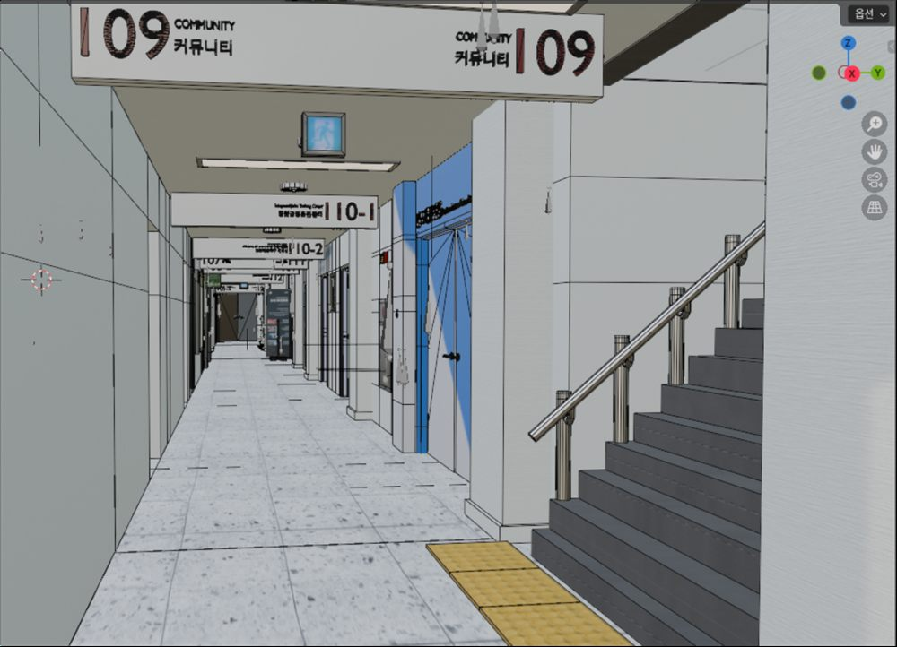
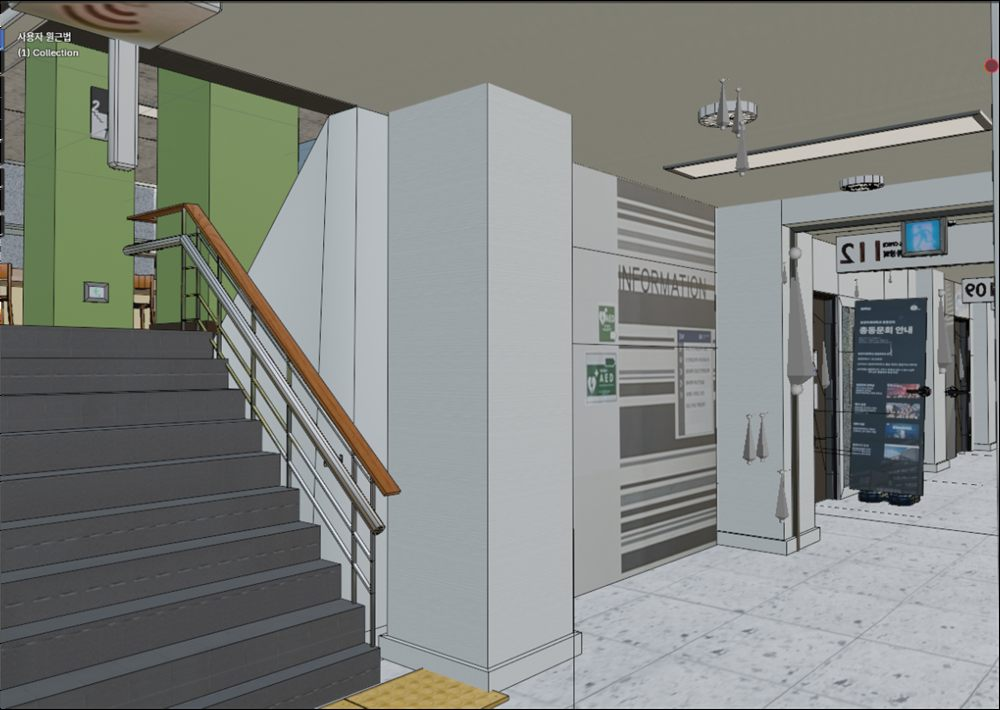
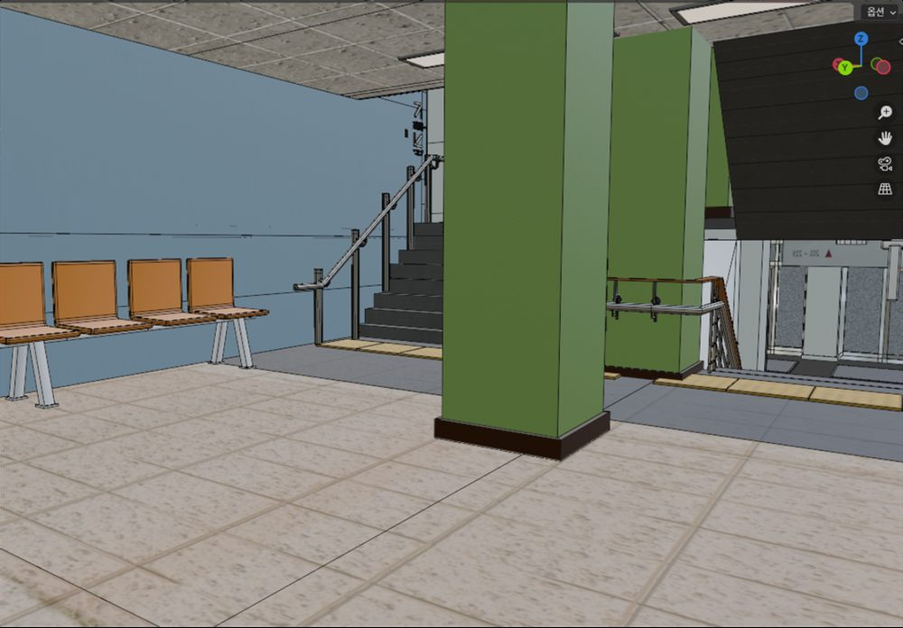
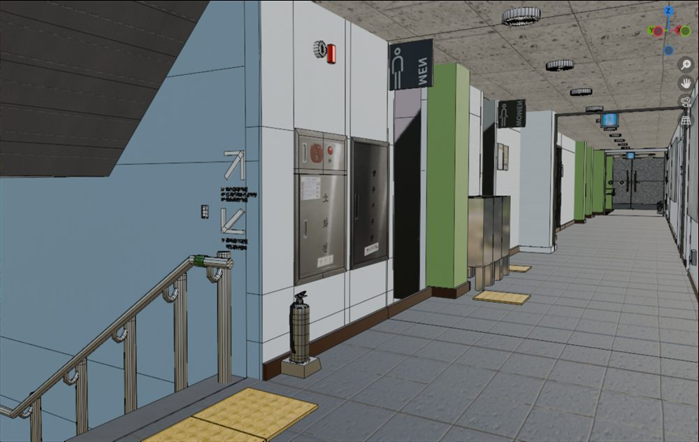
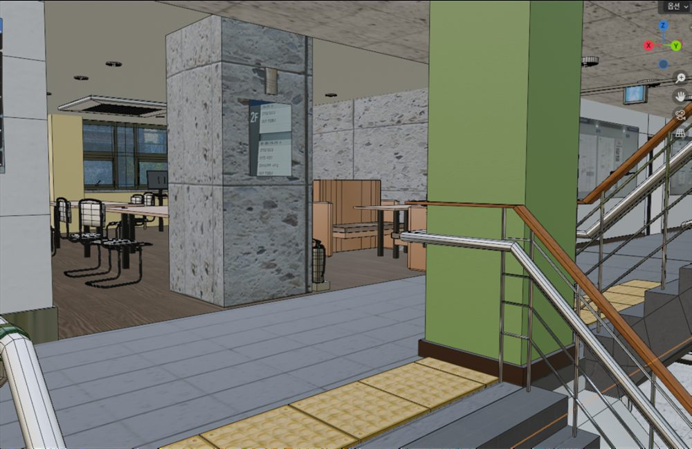
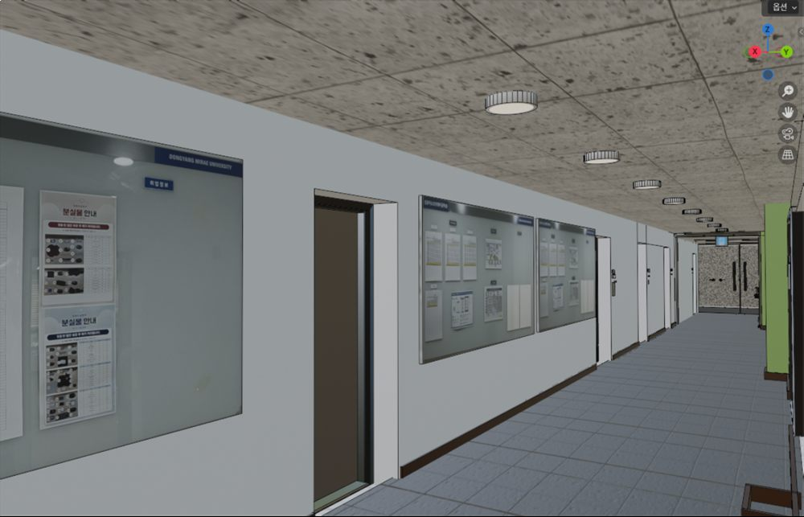

<div align="center">

# 🔥 EXIT CODE : RED

### 학교 건물을 1:1로 옮겨 온 VR 화재 대피 시뮬레이션

동양미래대학교 3호관을 실측 기반으로 똑같이 모델링한 디지털 트윈 공간에서,<br>
Meta Quest 3를 쓰고 **불이 난 우리 학교를 직접 빠져나오는** 체험형 안전 교육 콘텐츠예요.


**팀 HOT ESC** · 2025.12 · 졸업작품

[🎬 시연 영상 보기](https://github.com/urimll/EXIT-CODE-RED/releases/download/v1.0/EXIT-CODE-RED-demo.mov) &nbsp;·&nbsp; [📦 릴리스 v1.0](https://github.com/urimll/EXIT-CODE-RED/releases/tag/v1.0)



</div>

> 🎬 시연 영상(283MB, MOV)은 GitHub 파일 크기 한도(100MB)를 넘어서 저장소 대신 <b><a href="https://github.com/urimll/EXIT-CODE-RED/releases/tag/v1.0">Releases</a></b>에 올려 두었어요.

---

## 💡 왜 만들었나요?

### 🚨 심각한 화재 사고 피해
- 우리나라에서는 **해마다 평균 4만 1,257건**의 화재가 일어나요.
- 화재는 큰 인명 피해와 재산 피해로 이어지기 때문에, **효과적인 대피 훈련**이 점점 더 중요해지고 있어요.

### 📺 기존 화재 교육의 한계
- 학교에서 매 학기 하는 안전 교육은 대부분 **전자칠판으로 영상을 보는 방식**이에요.
- 보기만 하는 수동적인 교육이라 **몰입하기 어렵고**,
- 훈련 환경이 **실제 건물 구조와 달라서**, 위기 상황에서 바로 판단하는 힘을 기르기 어려워요.

### 💭 그래서 떠올린 질문

> **"실제 학교와 똑같은 환경에서, 진짜 불이 난 것 같은 몰입감으로 훈련할 수는 없을까?"**

매일 다니는 익숙한 공간에서 재난 상황을 미리 겪어 보면 실제 대응 능력이 훨씬 좋아질 거라고 생각했어요.
그래서 VR 기술로 **실감형 화재 대피 시뮬레이션**을 만들었어요.

## ✨ 작품 특징

| | 특징 | 설명 |
|:---:|---|---|
| 🥽 | **몰입감** | VR 속에서 사용자가 직접 움직이고 행동하는 능동적인 참여 방식 |
| 🏫 | **실제 환경** | 학교 내부를 실제와 거의 똑같이 3D 모델링해서, 익숙한 공간에서 화재 대응을 훈련 |
| 🧠 | **공간 기억** | 익숙한 공간이 재난 현장으로 바뀌는 강렬한 경험 → 실제 상황에서 빠르게 공간을 파악하고 대응 |
| 🚪 | **대피 훈련** | 비상구 위치와 대피 경로를 익히고, 소화기 위치와 사용법을 직접 실습 |
| 🔁 | **실전 학습** | 이론 위주 교육보다 높은 몰입감과 학습 효과, 반복 훈련으로 위기 대응 능력 향상 |

## 🗺 맵 소개

동양미래대학교 **3호관 1~2층을 실측해서 1:1 비율로** 모델링했어요.
소화기와 소화전, 비상 유도등은 **실제 건물과 같은 위치**에 있고, 호실 표지판·게시판·점자 블록 같은 세부 디테일까지 살렸어요.

<table>
  <tr>
    <td></td>
    <td></td>
  </tr>
  <tr>
    <td align="center">1층 중앙홀 · 안내판</td>
    <td align="center">1층 계단과 대기 공간</td>
  </tr>
  <tr>
    <td></td>
    <td></td>
  </tr>
  <tr>
    <td align="center">실제 위치 그대로 둔 소화기 · 소화전</td>
    <td align="center">2층 라운지와 계단</td>
  </tr>
  <tr>
    <td colspan="2"></td>
  </tr>
  <tr>
    <td colspan="2" align="center">2층 복도 · 게시판과 강의실 문</td>
  </tr>
</table>

## 🎮 두 가지 모드

### 📘 교육 모드 (Training Mode)
> 시간 제한도, 압박감도 없이 자유롭게 배우는 모드

- 시뮬레이션을 시작하기 전에 **소방청 권고 행동 요령**을 먼저 배워요.
- **3D 바닥 유도선**과 안내 화살표가 가장 가까운 비상구까지 길을 알려 줘요.
- **문 열기 전 손잡이 온도 확인**으로 백드래프트 위험을 미리 알아채는 습관을 길러요.
- **소화기 사용 3단계를 3D 가이드로 직접 해 봐요.** 안전핀 뽑기(그립) → 노즐 조준 → 손잡이 누르기(트리거)
- 실수해도 괜찮아요. **몇 번이든 다시 해 보며** 익힐 수 있어요.

### 🔥 실전 모드 (Challenge Mode)
> 예고 없이 터지는 화재에 바로 대응해야 하는 모드

- 유도선과 소화기 사용법 같은 **안내 UI가 모두 꺼져요.** 기억과 유도등만 보고 탈출해야 해요.
- **체력 바 = 골든타임.** 시간이 지날수록 체력이 줄고, 불에 닿으면 빠르게 줄어요. 0이 되기 전에 탈출해야 해요.
- 시야를 가리는 **짙은 연기**가 있어요.
- **소화기로 끌 수 있는 불과 끌 수 없는 불을 구분**해야 해요. 통로를 막은 큰 불은 잠깐 줄어들었다가 다시 커져요.
  "초기 진압이 안 되는 불은 무리하지 말고 우회한다"는 수칙을 몸으로 익히게 돼요.
- **백드래프트**가 일어나요. 👇
- 탈출하면 **남은 HP**로 대응 숙련도를 평가해요.

### 💥 백드래프트 구현

> **백드래프트(Backdraft)란?**
> 산소가 부족한 밀폐 공간에서 불이 계속 타다가, 문이나 창문을 여는 순간 바깥 산소가 갑자기 들어오면서
> 불길이 폭발하듯 뿜어져 나오는 현상이에요.

- 백드래프트의 전조 증상인 **뜨거운 문손잡이를 빨간색으로** 보여 줘요.
- 여러 문 가운데 **무작위로** 달궈진 손잡이가 생겨요. 매번 위치가 달라요.
- 달궈진 문을 열면 **불길이 앞쪽으로 폭발**해요.
- 이 불길은 소화기로 끌 수 없어요. **다른 길로 돌아서** 대피해야 해요.

### 🤔 왜 모드를 둘로 나눴나요?

1. 먼저 **교육 모드**에서 올바른 행동을 배우고, 실제와 비슷한 환경에서 반복해서 적용해 봐요.
2. 그다음 **실전 모드**의 탈출 성공·실패 결과를 겪으면서, 무엇이 올바른 행동인지 스스로 깨달아요.

이 흐름 덕분에 단순한 이론형 소방 교육보다 **훨씬 오래 기억에 남는 교육**이 돼요.

## 🛠 기술 구현

### 🧱 3D 에셋 파이프라인 (Blender)
| 단계 | 내용 |
|---|---|
| **실측 기반 모델링** | 3호관을 실제 크기와 **1:1 비율**로, 기본 큐브에서 시작해 폴리곤 방식으로 세부 디테일까지 제작 |
| **사실적인 텍스처** | 블렌더 **노드 에디터**로 빛 반사와 표면 질감을 절차적으로 연결해서 벽·바닥 재질을 사실적으로 표현 |
| **애니메이션 · 최적화** | 문 여닫기 같은 기본 애니메이션은 블렌더에서 미리 적용하고, 모든 에셋을 **FBX**로 내보내 Unity에 최적화된 상태로 임포트 |

### ⚙️ 핵심 로직 (Unity · C#)
| 기능 | 내용 |
|---|---|
| **동적 화재 시스템** | **4단계 파티클**(Max → 중간 → Min → 꺼짐)로 만든 불. 소화기와 불의 충돌을 실시간으로 감지하고, C# 스크립트로 파티클 양과 크기를 조절해서 바로 눈에 보이는 피드백을 줘요 |
| **모드별 로직 분리** | 교육 모드에서는 유도선(Cube Mesh)을 켜고, 실전 모드에서는 자동으로 꺼요. 모드 전환은 스크립트로 관리해요 |
| **긴급성을 강조하는 타이머** | 실전 모드의 체력 바는 골든타임 개념이에요. 남은 시간이 **50% 미만이면 노란색**, **20% 미만이면 빨간색**으로 바뀌어서 급박함을 눈으로 느끼게 해요 |
| **VR UI** | 모든 UI를 **World Space Canvas**로 만들어 VR에 맞췄어요. 체력 상태, 홈 화면, 안내 메시지, 교육 정보를 보여 줘요 |

### 🎮 VR 상호작용 (XR Interaction Toolkit)
- Meta Quest 3 컨트롤러의 **버튼마다 기능을 직접 매핑**해서 현실감 있게 조작해요.
  - **그립 버튼** → 소화기 잡기 · 안전핀 뽑기
  - **트리거 버튼** → 소화기 분사
- 문손잡이 잡기, 문 열기 같은 동작도 실제와 비슷하게 할 수 있어요.
- 이동은 **텔레포트**와 **스냅 턴**을 써요.

### 🧩 시스템 구조

| 계층 | 구성 |
|---|---|
| 사용자 입력 | Input Action Manager (트리거·그립·조이스틱), 텔레포트·스냅 턴 이동 |
| 코어 로직 | Interaction Manager (문·소화기), Game Manager (모드 전환·제한 시간·성공/실패 판정) |
| 환경 반응 | Fire & Smoke Controller (불·연기 확산과 진압), Status System (HP 계산) |
| 렌더링 | 최적화한 메시·텍스처, 라이트맵, World Space UI |

## 🗂 스크립트 안내

| 스크립트 | 역할 |
|---|---|
| `StartManager` | 시작 화면. 교육 모드 설명 페이지를 앞뒤로 넘기고, 끝나면 게임 씬으로 넘어가요 |
| `BackendManager` | 고른 난이도(교육/실전)를 씬이 바뀌어도 기억하는 싱글턴 |
| `Player` | 게임의 중심. 모드(Easy/Hard) 설정, **HP 바**와 시간에 따른 체력 감소, 소화기 **안전핀 → 조준 → 분사** 순서 확인, 단계별 안내 문구, 비상구 화살표, 탈출/게임 오버 화면, NavMesh로 맵 밖 이동 막기 |
| `QuestFire` | 불 오브젝트. 소화액(`Bullet`)에 맞으면 작아지고, **꺼지지 않는 큰 불**(`CantFire`)은 잠깐 줄었다가 다시 커져요 |
| `DoorInteraction` | 손(`Hand` 태그)이 닿으면 문이 열려요. 실전 모드에서 **달궈진 손잡이** 문을 열면 불길이 터져 나와요(백드래프트) |
| `CamCtrl` | 에디터 테스트용 카메라. 마우스 우클릭 회전, WASD/QE 이동, Shift 가속 |

## 🎬 체험 흐름

```
StartScene                         GameScene
┌─────────────┐  교육 모드 선택  ┌──────────────────────────────────┐
│ 모드 선택    │ ───────────────▶ │ 바닥 유도선·안내 문구를 따라 이동   │
│ 교육 / 실전  │                  │ 소화기: 안전핀 → 조준 → 분사        │
└─────────────┘  실전 모드 선택  │ 비상구 도착 → 탈출 성공             │
       │        ───────────────▶ │ (실전) 안내 없음 · HP 감소 · 제한 시간 │
       │                         │ 달궈진 손잡이 → 백드래프트           │
       │                         │ HP 0 → 게임 오버                   │
       ▼                         └──────────────────────────────────┘
```

## 🛠 개발 환경

| 구분 | 내용 |
|---|---|
| 엔진 | Unity 6000.2.6f1 (URP) |
| 3D 모델링 | Blender 4.4 (학교 도면 기반 1:1 스케일) |
| 스크립트 | C#, Visual Studio 2022 |
| VR | Meta Quest 3 (Android Standalone), Unity XR Interaction Toolkit |
| 이펙트·사운드 | Unity Particle System, Meta XR Audio (공간 음향) |
| 협업 | GitHub, Notion |

## 👥 팀 HOT ESC

| 역할 | 이름 | 담당 |
|---|---|---|
| 팀장 | 이유림 ([@urimll](https://github.com/urimll)) | 게임 전체 로직(교육/실전 모드 제어, HP 시스템, 백드래프트 제어, 랜덤 달궈진 손잡이), XR Grab·Ray 인터랙션, 내비게이션 영역 제한, UI/UX(비상구 방향·체력 게이지·안내 메시지), 2층 복도·출입문·조명 모델링, 라이트맵, 일정 관리와 문서화 |
| 팀원 | 김찬영 | VR 컨트롤러 입력 처리, 문 개폐 상호작용, 백드래프트 구현, 중앙홀·계단 모델링 |
| 팀원 | 김민석 | 1층 복도·소화기·비상등 모델링, 화염·연기 파티클, 연기 노출에 따른 시야 흐림·체력 감소, 파티클 최적화 |

## 🚀 앞으로 해 보고 싶은 것
- 기류와 가연물 배치에 따라 화염과 연기가 퍼지는 AI 기반 화재 시뮬레이션
- 시선·이동 경로·반응 속도를 기록해서 개인별 취약점을 알려주는 평가 시스템
- 옥상·특수 교실, 야간 화재 같은 시나리오 확장
- 휠체어 모드 같은 배리어프리 훈련

## 📂 저장소 구성

| 폴더 | 내용 |
|---|---|
| `Assets/Scripts` | `Player`(모드·HP·소화기·손잡이), `QuestFire`, `DoorInteraction`, `StartManager`, `CamCtrl` |
| `Assets/Scenes` | `StartScene`(모드 선택), `GameScene`(본 게임) |
| `Assets/Models`, `Assets/school2.fbx` | 학교 건물·문 3D 모델 |
| `Assets/Textures`, `Assets/Materials` | 건물 텍스처와 머티리얼 |

## ⚙️ 실행 방법

1. **Unity 6000.2.6f1**로 이 폴더를 열어요. 패키지(`Packages/manifest.json`)는 자동으로 설치돼요.
2. 아래 빠진 에셋을 프로젝트에 다시 넣어요.
3. `Assets/Scenes/StartScene`을 열고, Meta Quest 3를 연결해서 실행하거나 Android로 빌드해요.

### 저장소에 넣지 않은 것

| 항목 | 이유 | 다시 넣는 방법 |
|---|---|---|
| `Assets/Models/school2.fbx` (304MB), `school2.fbm/` | GitHub 파일 크기 한도(100MB) 초과, 텍스처 중복 | 팀 공유 드라이브에서 받기 |
| AllSkyFree, Ian's Fire Pack Universal, CurvedUI, VR_Bire_Bottle, JsonDotNet | 에셋스토어 에셋(재배포 불가) | Unity Asset Store에서 임포트 |
| Pretendard 폰트 | 용량 | [Pretendard](https://github.com/orioncactus/pretendard)에서 받아 `Assets/Font`에 넣기 |
| TextMesh Pro, XR 샘플, VR Template 에셋 | Unity 패키지로 다시 받을 수 있음 | Package Manager에서 임포트 |
